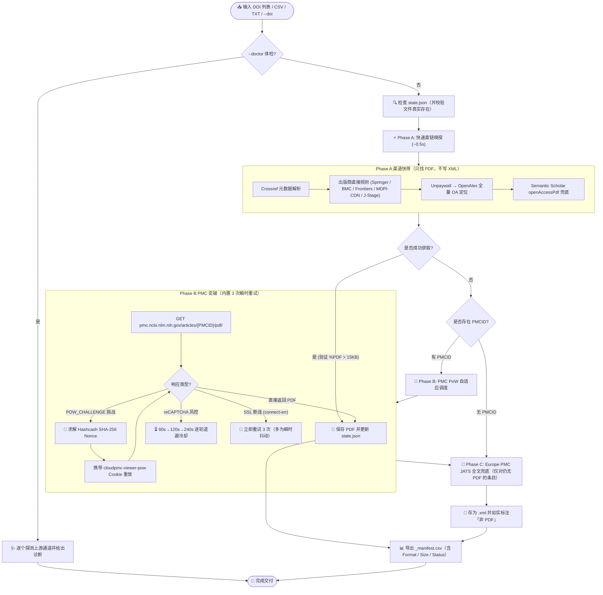

<div align="center">


# 📄 OA-PDF-Download

**面向学术科研与 AI Agent 的高可靠合法开源学术论文（Open Access）批量下载工具**

[](https://opensource.org/licenses/MIT)
[](https://www.python.org/)
[](https://en.wikipedia.org/wiki/Open_access)
[](https://pmc.ncbi.nlm.nih.gov)
[](#-国内网络深度优化)

*零付费墙翻越 · 严格合规 · 智能两阶段调度 · 独家 PMC Hashcash PoW 自动破解 · 断点无损续传*

[English Overview](#-overview) • [核心特性](#-核心特性) • [流程架构](#-流程架构) • [支持出版商](#-支持出版商与路由对照) • [安装与配置](#-安装与使用指南) • [命令行参数](#-命令行参数详解)

</div>

---

## 💡 Overview

**oa-pdf-download** 是一款专为研究人员与自主 AI Agent（如 Antigravity / Claude Code / Cursor / Dify 等）打造的学术文献批量获取利器。针对学术文献检索后的大批量全文下载需求，它能从输入的一组 DOI 清单（或 Excel/CSV 文献表）中，**自动、合法合规地批量抓取全部 Open Access (OA) 论文 PDF 全文**，并清晰、真实地报告无法获取文献的原因（如完全付费墙、仅 HTML 无 PDF 等）。

> [!NOTE]
> **真实实战验证**：在 2026 年 10 月的一次冠状病毒兽医文献实测中，输入 74 篇混合文献列表，单次会话无需人工干预稳定抓取 **51 篇** 完整合法 PDF 全文（成功率达 69%）。

---

## ✨ 核心特性

- 🛡️ **100% 合规与合法 OA 通道**
  - 严守学术合规红线，仅从合法的开放获取端点、机构仓储与预印本源下载。
  - **绝不绕过付费墙，不连接 Sci-Hub**，不使用任何未授权 Cookie。未开放获取的文献将如实标明，便于通过高校机构校园网购买权限检索。
- 🧩 **独家 PMC Hashcash Proof-of-Work (PoW) 自动应答**
  - 针对 `pmc.ncbi.nlm.nih.gov` 设置的浏览器防爬 Hashcash 挑战（4 难度 SHA-256 碰撞），内置纯 Python 高速算力求解器，自动生成 `cloudpmc-viewer-pow` 验证通行证。
  - **瞬时断连自动重试**：PMC 常在第一次请求时用 `SSL: UNEXPECTED_EOF_WHILE_READING` 掐断连接，第二次就正常返回。脚本对这类抖动内置 3 次递增重试，不再把「抖了一下」误判成「下不到」。
- ⚡ **三阶段智能调度管道 (Phase A / B / C)**
  - **Phase A (快筛阶段)**：秒级扫描 Springer, BMC, Frontiers, MDPI-CDN, J-Stage，再叠加 **Unpaywall → OpenAlex** 全量 OA 定位，最后以 Semantic Scholar 兜底。**此阶段只找 PDF，不写 XML。**
  - **Phase B (精打阶段)**：多轮随机间隔退避调度 PMC，自动求解 PoW；识别 reCAPTCHA 风控并按 60s → 120s → 240s 逐轮退避冷却（冷却后挑战会恢复为 PoW，可继续）。
  - **Phase C (兜底阶段)**：仅对前述全部失败、且确有 PMCID 的条目，降级保存 Europe PMC JATS 全文并标注格式。**刻意排在 PMC 之后**——早期版本在 Phase A 就写 XML，会把 DOI 从队列移除，使 PMC 阶段永远不执行。
- 🩺 **`--doctor` 环境体检**
  - 一次性探测 Crossref / Unpaywall / OpenAlex / Europe PMC / PMC / MDPI CDN / Wiley / Cell Press，逐项给出 `ok` / `blocked` / `throttled` / `unreachable` 与结论。
  - 直接回答「是网络被封，还是这篇文章本来就没有 OA」，比盯着 `0/N` 猜快得多。
- 🔗 **出版商自有 CDN 优先策略**
  - MDPI 等平台的主站常挂在 Akamai / Cloudflare 之后，机房或代理 IP 极易被判 403；脚本优先走其自有静态 CDN（如 `mdpi-res.com`），**绕过 WAF 边缘拦截**，实测同一篇论文主站 403、CDN 却是 200 / 21 MB 正常 PDF。
- 🇨🇳 **深度适配国内学术网络环境**
  - 彻底规避 `www.ncbi.nlm.nih.gov` 在国内部分网络下的 DNS 污染异常，重定向至高可用的 `pmc.ncbi.nlm.nih.gov` 与 Europe PMC API。
  - 优雅处理 Cloudflare 403 阻断，自动降级至稳定仓储镜像。
  - `--verbose` 会打印**完整的 SSL 异常原文**，让 `connect-err` 从黑箱变成可判断（是对端重置、超时还是 DNS）。
- 💾 **事务级断点续传 (Crash-Safe)**
  - 采用原子状态文件 `state.json`，每下载成功一篇立即安全落盘。
  - 随时中断（Ctrl+C 或超时杀进程）后重新启动可无缝跳过已完成项目。
  - **同时校验文件是否真实存在**：文件被删掉后不会因为 state 里还留着记录就永久跳过；`--force` 可无视记录全部重下。
- 📑 **学术归档级命名与 Manifest 报告**
  - `--filename title` 直接以**完整文章标题**命名（去 JATS 内联标签、转义 HTML 实体、替换 Windows 非法字符，并在**词边界**截断，不会切出 `...inflammato` 这种断词）；默认 `slug` 为 `{年份}_{短标题}.pdf`。
  - 自动校验 `%PDF` 文件魔数与体积阈值（>15KB），坚决杜绝把 HTML 拦截页误存为 PDF。
  - `_manifest.csv` 含 `DOI / Title / Year / Format / Size / Filename / Source / Status` 八列，能直接看出每篇的格式、来源，以及「文件已不在本地」这类状态。

---

## 🏗️ 流程架构



> **关键顺序**：XML 兜底被刻意放在 **Phase C**，即 PMC 之后。早期版本在 Phase A 就写 XML 并移除该 DOI，导致 PMC 阶段不再执行——能从 PMC 正常下到 PDF 的文献只剩一个 XML。

---

## 🌐 支持出版商与路由对照

| 出版社 / 平台 | 典型 DOI 前缀 | 获取策略与说明 | 支持状态 |
|:---|:---|:---|:---:|
| **Springer** | `10.1007` | 通用直链 `link.springer.com/content/pdf/{doi}.pdf` | ✅ 完全支持 |
| **BioMed Central (BMC)** | `10.1186` | BMC 计数器端点及 Springer 回退端点 | ✅ 完全支持 |
| **Frontiers** | `10.3389` | 官方文章直链与期刊专栏 PDF 模式 | ✅ 完全支持 |
| **MDPI** | `10.3390` | **优先走自有 CDN `mdpi-res.com`**（文件名规则 `{刊}-{卷}-{文章号补零5位}`），主站 ISSN 直连作为备选 | ✅ 完全支持 |
| **J-Stage** | `10.1292`, `10.1294` 等 | 卷期页码结构化直链；支持 Landing Page 解析兜底 | ✅ 完全支持 |
| **NCBI PMC** | 任意带 PMCID 论文 | 求解 Hashcash PoW Cookie 挑战（含 Elsevier 存证） | ✅ 独家支持 |
| **Unpaywall** | 任意 DOI | `api.unpaywall.org` 返回 `best_oa_location.url_for_pdf`，**API 不在出版商 WAF 之后** | ✅ 完全支持 |
| **OpenAlex** | 任意 DOI | `api.openalex.org` 遍历全部 `locations[].pdf_url` | ✅ 完全支持 |
| **Europe PMC** | 任意带 PMCID 论文 | `rest/{PMCID}/fullTextXML` 取 JATS 全文（PDF 端点已废弃，不再尝试） | ✅ 全文XML |
| **Semantic Scholar** | 任意 DOI | 调用 S2 Graph API 检索机构知识库与预印本合法公开源（共享 IP 易 429） | ⚠️ 限流 |
| **Scialert** | `10.3923` | 解析 Abstract 提取附件（部分文献仅有 HTML 无 PDF） | ⚠️ 尽力支持 |
| **Elsevier / Wiley / Sage** | `10.1016`, `10.1111` 等 | **非 OA 付费墙期刊**；若论文已存入 PMC 则可下，否则明确报告 | ℹ️ 仅限已存入OA |

---

## 🚀 安装与使用指南

### 作为 AI Agent Skill 安装（推荐）

本仓库遵循跨平台 AI Agent Skill 规范，适用于 **Antigravity**、**Claude Code**、**Cursor** 等开发助手：

#### 1. 安装位置
直接克隆或复制本项目至 Agent 的技能发现目录：

```bash
# 全局生效 (推荐)：
git clone https://github.com/JL666788/oa-pdf-download.git ~/.agents/skills/oa-pdf-download

# 或仅在当前项目生效：
git clone https://github.com/JL666788/oa-pdf-download.git <your-project>/.skills/oa-pdf-download
```

#### 2. 自然语言直接调用
在与 AI 对话时直接提出文献下载需求，Agent 会自动加载本技能并在后台稳妥执行：
- *「把这篇表格里的文献能下载的 OA 全文都下载下来」*
- *「帮我把 records.csv 中的文献 PDF 下载到 output 目录，并如实汇报哪些是付费论文」*
- *「Batch download OA full texts for these papers and generate the manifest.」*

---

### 作为独立 Python 脚本运行

#### 1. 环境准备
需要 Python 3.10+，仅依赖 `requests` 库，轻量纯净：

```bash
git clone https://github.com/JL666788/oa-pdf-download.git
cd oa-pdf-download
pip install -r requirements.txt
```

#### 2. 准备文献清单
支持以下任一输入格式：
- **CSV 文件**（推荐）：包含 `DOI` 列，可选包含 `文献名`（或 `title`）、`年份`（或 `year`）列用于生成清晰文件名。
- **TXT 文件**：每行一个 DOI 纯文本。

参考自带的示例：[`examples/sample_papers.csv`](examples/sample_papers.csv)

#### 3. 运行下载命令

```bash
python scripts/fetch_oa_pdfs.py \
    --input examples/sample_papers.csv \
    --outdir ./PDFs \
    --state ./state.json \
    --email your_real_email@univ.edu.cn \
    --deadline-min 45
```

> [!TIP]
> 传入真实邮箱（`--email`）将进入 Crossref API 的 "Polite Pool"，享受更高优先级的解析速度与配额。

---

## 🖥️ 终端交互效果

运行过程中，脚本会以结构化彩色日志清晰呈现下载进度与当前渠道：

```text
============================================================
  OA-PDF-Download: Harvester Pipeline Initialized
============================================================
Total records: 5 | Completed: 0 | Pending: 5
Output Directory: /workspace/PDFs
State Path: /workspace/state.json

▶ Phase A: Fast Direct & Repository Routes (~0.5s pacing)
[01/05] Scanning: 10.1186/s12917-020-02422-9 (Pathogenicity and molecular characteristics o...)
  [✓] Saved (1428 KB): 2020_pathogenicity-and-molecular-characteristics-of-canine.pdf (via bmc-counter)
[02/05] Scanning: 10.3389/fvets.2021.731464 (Epidemiology and Evolution of Canine Coronavi...)
  [✓] Saved (2104 KB): 2021_epidemiology-and-evolution-of-canine-coronaviruses.pdf (via frontiers-doi)
[03/05] Scanning: 10.3390/v12050514 (A Review of Porcine Epidemic Diarrhea Virus...)
  [✓] Saved (876 KB): 2020_a-review-of-porcine-epidemic-diarrhea-virus-and-vaccine.pdf (via mdpi)

▶ Phase B: PMC Harvester with PoW Solver (Adaptive Pacing)
Found 2 items with associated PMCID.

--- Round 1: Attempting 2 PMC items ---
Pacing 18.4s | Attempting 10.1016/j.jcv.2020.104374 (PMC7199723)...
  [✓] Saved (512 KB): 2020_first-cases-of-coronavirus-disease-2019-in-france.pdf (via pmc:PMC7199723)

============================================================
  DOWNLOAD HARVEST SUMMARY
============================================================
Total Papers: 5
Successfully Harvested: 4/5 (80.0%)

Breakdown by Source Channel:
  • bmc-counter         :   1 PDFs
  • frontiers-doi       :   1 PDFs
  • mdpi                :   1 PDFs
  • pmc                 :   1 PDFs

Unobtained / Paywalled Papers (1):
  ✗ 10.1055/a-1234-5678 - Paywalled clinical study without public OA deposit

Manifest saved to: /workspace/PDFs/_manifest.csv
State file saved to: /workspace/state.json
```

---

## ⚙️ 命令行参数详解

| 参数项 | 简写 | 必填 | 默认值 | 详细说明 |
|:---|:---:|:---:|:---:|:---|
| `--doi` | - | 二选一 | - | 直接在命令行给出一个或多个 DOI，无需准备文件 |
| `--input` | `-i` | 二选一 | - | 输入文件路径（支持 CSV 或 TXT） |
| `--outdir` | `-o` | 否 | `PDFs` | PDF 全文保存的输出目录 |
| `--state` | `-s` | 否 | `state.json` | 进度状态记录 JSON，支持断点续传 |
| `--deadline-min` | - | 否 | `30` | 任务总截止时间（分钟），避免后台无限阻塞 |
| `--pmc-delay` | - | 否 | `10 20` | PMC 抓取时的最小/最大随机间隔秒数（防反爬） |
| `--email` | - | 否 | `""` | 真实联系邮箱，用于触发 Crossref / Unpaywall 优待池 |
| `--skip-pmc` | - | 否 | `False` | 跳过 Phase B（仅执行 Phase A 快速扫描） |
| `--verbose` | `-v` | 否 | `False` | 输出更详细的网络探测与 HTTP 调试信息（含 SSL 错误原文） |
| `--no-xml-fallback` | - | 否 | `False` | 禁止在拿不到 PDF 时降级保存 Europe PMC JATS 全文 XML |
| `--force` | - | 否 | `False` | 忽略 state.json 的已完成记录，强制重新下载 |
| `--filename` | - | 否 | `slug` | 命名策略：`slug` → `{年份}_{短标题}.pdf`；`title` → `{完整文章标题}.pdf` |
| `--doctor` | - | 否 | `False` | 体检模式：逐个探测各上游通道并给出诊断结论，不下载任何文件 |
| `--no-color` | - | 否 | `False` | 禁用终端 ANSI 彩色转义序列 |

> **出问题先跑体检**：`python scripts/fetch_oa_pdfs.py --doctor --email you@example.com`。
> 它会把 Crossref / Unpaywall / OpenAlex / Europe PMC / PMC / MDPI CDN / 各出版商逐个探测一遍，
> 直接告诉你「是网络被封还是文章本身没有 OA」，比盯着 `0/N` 猜要快得多。
>
> 完整排障清单见 **[TROUBLESHOOTING.md](TROUBLESHOOTING.md)**（含症状→原因→处置速查表与真实案例复盘）。

---

## ❓ 常见问题 (FAQ)

<details>
<summary><b>Q1: 为什么有些论文没有下载下来？</b></summary>
<br>
本工具严格遵守版权法规，只下载合法的开放获取（Open Access）全文。若论文属于传统商业订阅期刊（如未选择 OA 出版的 Elsevier、Wiley、Sage、Thieme 期刊），且作者未在 PubMed Central / 机构知识库自存档，工具将诚实标记为未获取。建议通过您所在大学或科研机构的校园网代理或图书馆馆际互借获取。
</details>

<details>
<summary><b>Q2: 下载到一半被中断或者报错怎么办？</b></summary>
<br>
无需担心！由于内置事务级状态管理（`state.json`），脚本在每成功下载一篇文献后都会立即写入状态。只需重新执行原命令，脚本会自动跳过所有已下载文献，直接继续未完成的任务。
</details>

<details>
<summary><b>Q3: 在国内网络访问 NCBI/PMC 提示超时或连接被重置？</b></summary>
<br>
工具内部已主动回避了受污染的 <code>www.ncbi.nlm.nih.gov</code>，转而采用 <code>pmc.ncbi.nlm.nih.gov</code> 以及欧洲生物信息研究所的 Europe PMC 镜像。如果您的局域网环境对境外学术服务器限制较严格，可配置标准环境变量代理：
<pre><code>export HTTP_PROXY="http://127.0.0.1:7890"
export HTTPS_PROXY="http://127.0.0.1:7890"</code></pre>
<br>
但实测有一反直觉现象值得知道：<b>对 NCBI 而言，挂代理不一定更好，反而可能更差</b>。同一台机器上曾出现「代理全开时 PMC 一直握手失败，关掉代理用国内宽带直连反而 200」。原因是 NCBI 会对大量机场/机房出口节点直接重置 TLS 握手，与节点速度快慢无关。若 PMC 反复失败，先试<b>关掉代理直连</b>，再试换节点，不要默认「一定是没挂代理」。
</details>

<details>
<summary><b>Q4: 明明挂了代理、ChatGPT 也能用，为什么下载全返回 403？</b></summary>
<br>
这不是代理没生效，而是<b>出口 IP 的信誉问题</b>。很多机房/机场 IP 被 Cloudflare、Akamai 集中标记，表现为：
<ul>
<li>Wiley / APS / Cell / Elsevier / <code>europepmc.org</code> → 统一返回 <b>403</b> 与约 5.8 KB 的挑战页；</li>
<li>MDPI 主站 → <b>403 Access Denied</b>（但自有 CDN <code>mdpi-res.com</code> 仍可 200）；</li>
<li>NCBI 全部子域（<code>pmc</code> / <code>www</code> / <code>eutils</code> / <code>ftp</code>）→ TLS 握手直接被断开。</li>
</ul>
排查方法：先跑 <code>--doctor</code>，若多个不同出版商同时 403，基本可判定为 IP 被封，请<b>更换出口节点</b>（优先住宅 IP 或换一家机场），而非反复重试。
<br><br>
另外注意：使用 TUN 模式（如 FlClash 的 <code>global</code> + TUN）时，<b>所有流量都被系统级接管</b>，此时 <code>curl --noproxy</code> 与 <code>-x 127.0.0.1:7890</code> 的出口 IP 必然相同——不能据此判断「代理没生效」。
<br><br>
补充：<b>Cloudflare 的「Just a moment…」是 JS 托管挑战</b>，用 TLS 指纹模拟（如 <code>curl_cffi</code> 的 <code>impersonate="chrome"</code>）和无头 Chrome 都过不去，因为拦你的是需要执行 JS 的那一步。这类站点只能靠<b>真实浏览器</b>手动点击。
</details>

<details>
<summary><b>Q5: 为什么有时保存的是 .xml 而不是 .pdf？</b></summary>
<br>
当所有合法 PDF 通道都不可用时，脚本会在<b>最后的 Phase C</b> 降级保存 Europe PMC 的 JATS 全文 XML（含完整正文与参考文献），<b>文件名后缀为 <code>.xml</code> 并明确标注「全文XML非PDF」</b>，绝不会把 XML 或 HTML 拦截页冒充成 PDF。若不需要此兜底行为，加 <code>--no-xml-fallback</code>。
<br><br>
<b>注意这个保底是刻意排在 PMC 之后的</b>：早期版本在 Phase A 就写 XML 并把该 DOI 从队列移除，导致 Phase B 的 PMC PDF 阶段根本没机会执行——明明从 PMC 一秒就能下到 PDF，却只留下一个 XML。如果你只要 PDF，请<b>不要</b>用 <code>--no-xml-fallback</code> 来"加速"，它的作用只是不写兜底文件，不改变通道顺序。
</details>

<details>
<summary><b>Q6: 日志里满屏 <code>connect-err</code> / <code>SSL UNEXPECTED_EOF_WHILE_READING</code> 是什么意思？</b></summary>
<br>
这是 <b>TLS 连接被对端主动掐断</b>，不是文章没有全文、也不是代码解析失败。判据很简单：同一篇文章、同一个 PMCID，换个网络就能下下来。
<ul>
<li>脚本对这类错误<b>会自动重试 3 次</b>（间隔递增），因为 PMC 的第一跳经常抖一下就断，第二次就正常；</li>
<li>加 <code>--verbose</code> 可以看到完整的 SSL 错误原文，而不是只有一句 <code>connect-err</code>；</li>
<li>连续多篇都这样，说明是<b>网络路径问题</b>，跑 <code>--doctor</code> 确认 PMC 那一行是不是 <code>unreachable</code>。</li>
</ul>
</details>

<details>
<summary><b>Q7: PMC 提示 <code>reCAPTCHA</code> / 出现「Checking your browser」怎么办？</b></summary>
<br>
说明请求频率把 PMC 的爬虫风控触发了。此时 <code>/pdf/</code> 返回的不再是 PoW 挑战页，而是一个约 20 KB 的 reCAPTCHA 拦截页。
<ul>
<li><b>不要连续重试</b>，越试锁得越久；脚本会按 60s → 120s → 240s 逐轮退避冷却；</li>
<li>冷却结束后会<b>自动恢复成 PoW 挑战页</b>，此时可正常求解并下载；</li>
<li>单篇实测比批量更容易过，批量时把 <code>--pmc-delay</code> 调大（如 <code>20 40</code>）更稳。</li>
</ul>
</details>

<details>
<summary><b>Q8: state.json 显示已完成，但目录里的 PDF 不见了，怎么重下？</b></summary>
<br>
旧版本只看 state 里的记录就跳过，文件被删了也不会重下。现在脚本会<b>同时校验文件是否真的存在</b>，不存在则视为待下载、自动重取。若想无视记录全部重来，加 <code>--force</code>。
</details>

<details>
<summary><b>Q9: 能否用文章标题（而不是「年份_短标题」）命名文件？</b></summary>
<br>
可以，加 <code>--filename title</code>。标题会做安全处理：去掉 JATS 内联标签（<code>&lt;scp&gt;</code>、<code>&lt;i&gt;</code> 等）、转义 HTML 实体、替换 Windows 非法字符，并在<b>词边界</b>截断——早期版本按字符硬切，会产生 <code>...specific inflammato</code> 这种断词的文件名。
</details>

<details>
<summary><b>Q10: 哪类文献注定拿不到？</b></summary>
<br>
<ul>
<li><b>bronze OA（如 Cell Press 部分文章）</b>：OpenAlex 标 <code>is_oa=true</code>，但 <code>any_repository_has_fulltext=false</code>，唯一来源是出版商站点且被 Cloudflare 拦住 → 只能人工用浏览器打开点击下载；</li>
<li><b>纯订阅文献且无绿色 OA 副本</b>（无 PMCID、无机构库存档）→ 任何合法工具都拿不到；</li>
<li><b>PMC 里只有免费 HTML、不提供 PDF 的条目</b>（<code>isOpenAccess=N</code>）→ 只能读 HTML，没有 PDF 可下。</li>
</ul>
用 <code>--doctor</code> 先分清是「网络拿不到」还是「本来就没有」，避免白折腾。
</details>

---

## ⚖️ 免责声明 (Disclaimer)

1. 本项目仅供学术科研交流与文献元数据整理之用。
2. 所有下载行为均基于公开合法的开放获取网络接口（Open Access Endpoints），不破解任何付费控制系统，不侵犯出版商版权。
3. 请使用者合理设置请求间隔（`--pmc-delay`），遵守各学术出版机构的《Robots 协议》及服务条款，切勿用于恶意高频爬取。

---

## 📄 License

本项目采用 [MIT License](LICENSE) 开源协议，欢迎 Star、Fork 与提交 Issue/PR 贡献代码！
