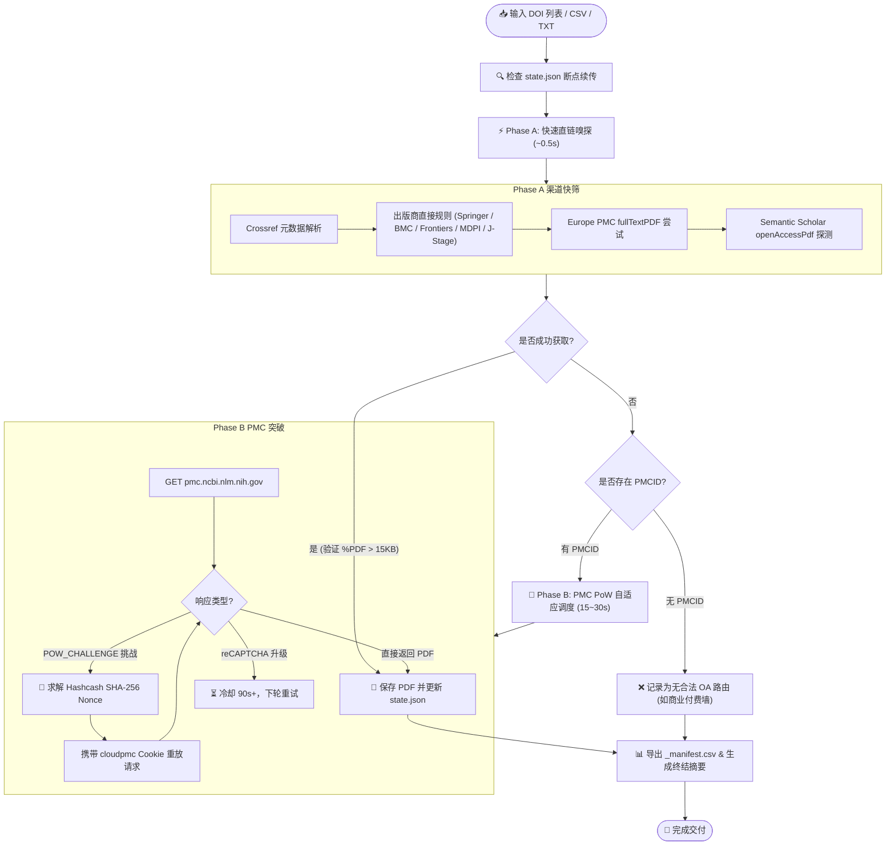

<div align="center">


# 📄 OA-PDF-Download

**面向学术科研与 AI Agent 的高可靠合法开源学术论文（Open Access）批量下载工具**

[](https://opensource.org/licenses/MIT)
[](https://www.python.org/)
[](https://en.wikipedia.org/wiki/Open_access)
[](https://pmc.ncbi.nlm.nih.gov)
[](#-国内网络深度优化)

*零付费墙翻越 · 严格合规 · 智能两阶段调度 · 独家 PMC Hashcash PoW 自动破解 · 断点无损续传*

[English Overview](#-overview) • [核心特性](#-核心特性) • [流程架构](#-流程架构) • [支持出版商](#-支持出版商与路由对照) • [安装与配置](#-安装与使用指南) • [命令行参数](#-命令行参数详解)

</div>

---

## 💡 Overview

**oa-pdf-download** 是一款专为研究人员与自主 AI Agent（如 Antigravity / Claude Code / Cursor / Dify 等）打造的学术文献批量获取利器。针对学术文献检索后的大批量全文下载需求，它能从输入的一组 DOI 清单（或 Excel/CSV 文献表）中，**自动、合法合规地批量抓取全部 Open Access (OA) 论文 PDF 全文**，并清晰、真实地报告无法获取文献的原因（如完全付费墙、仅 HTML 无 PDF 等）。

> [!NOTE]
> **真实实战验证**：在 2026 年 10 月的一次冠状病毒兽医文献实测中，输入 74 篇混合文献列表，单次会话无需人工干预稳定抓取 **51 篇** 完整合法 PDF 全文（成功率达 69%）。

---

## ✨ 核心特性

- 🛡️ **100% 合规与合法 OA 通道**
  - 严守学术合规红线，仅从合法的开放获取端点、机构仓储与预印本源下载。
  - **绝不绕过付费墙，不连接 Sci-Hub**，不使用任何未授权 Cookie。未开放获取的文献将如实标明，便于通过高校机构校园网购买权限检索。
- 🧩 **独家 PMC Hashcash Proof-of-Work (PoW) 自动应答**
  - 针对 `pmc.ncbi.nlm.nih.gov` 设置的浏览器防爬 Hashcash 挑战（4 难度 SHA-256 碰撞），内置纯 Python 高速算力求解器，自动生成 `cloudpmc-viewer-pow` 验证通行证。
- ⚡ **双阶段智能调度管道 (Two-Phase Pipeline)**
  - **Phase A (快筛阶段)**：秒级扫描 Springer, BMC, Frontiers, MDPI, J-Stage, Europe PMC 与 Semantic Scholar。
  - **Phase B (精打阶段)**：多轮随机间隔（15–30s）退避调度 PMC，智能监测 reCAPTCHA 升级风险并自动触发 90s+ 冷却机制。
- 🇨🇳 **深度适配国内学术网络环境**
  - 彻底规避 `www.ncbi.nlm.nih.gov` 在国内部分网络下的 DNS 污染异常，重定向至高可用的 `pmc.ncbi.nlm.nih.gov` 与 Europe PMC API。
  - 优雅处理 Cloudflare 403 阻断，自动降级至稳定仓储镜像。
- 💾 **事务级断点续传 (Crash-Safe)**
  - 采用原子状态文件 `state.json`，每下载成功一篇立即安全落盘。
  - 支持随时中断（Ctrl+C 或超时杀进程），重新启动无缝跳过已完成项目，避免重复请求。
- 📑 **学术归档级命名与 Manifest 报告**
  - 输出文件严格规整命名为 `{年份}_{标题-slug}.pdf`，方便按年份和论文题名索引检索。
  - 自动校验 `%PDF` 文件魔数与体积阈值（>15KB），坚决杜绝把 HTML 拦截页误存为 PDF。
  - 自动生成 `_manifest.csv` 映射清单与控制台分类统计报表。

---

## 🏗️ 流程架构



---

## 🌐 支持出版商与路由对照

| 出版社 / 平台 | 典型 DOI 前缀 | 获取策略与说明 | 支持状态 |
|:---|:---|:---|:---:|
| **Springer** | `10.1007` | 通用直链 `link.springer.com/content/pdf/{doi}.pdf` | ✅ 完全支持 |
| **BioMed Central (BMC)** | `10.1186` | BMC 计数器端点及 Springer 回退端点 | ✅ 完全支持 |
| **Frontiers** | `10.3389` | 官方文章直链与期刊专栏 PDF 模式 | ✅ 完全支持 |
| **MDPI** | `10.3390` | 根据 DOI 解析卷期号，自动映射标准 ISSN 直连 | ✅ 完全支持 |
| **J-Stage** | `10.1292`, `10.1294` 等 | 卷期页码结构化直链；支持 Landing Page 解析兜底 | ✅ 完全支持 |
| **NCBI PMC** | 任意带 PMCID 论文 | 求解 Hashcash PoW Cookie 挑战（含 Elsevier 存证） | ✅ 独家支持 |
| **Europe PMC** | 任意带 PMCID 论文 | EBI Europe PMC 开放 RESTful fullTextPDF 端点 | ✅ 完全支持 |
| **Semantic Scholar** | 任意 DOI | 调用 S2 Graph API 检索机构知识库与预印本合法公开源 | ✅ 完全支持 |
| **Scialert** | `10.3923` | 解析 Abstract 提取附件（部分文献仅有 HTML 无 PDF） | ⚠️ 尽力支持 |
| **Elsevier / Wiley / Sage** | `10.1016`, `10.1111` 等 | **非 OA 付费墙期刊**；若论文已存入 PMC 则可下，否则明确报告 | ℹ️ 仅限已存入OA |

---

## 🚀 安装与使用指南

### 作为 AI Agent Skill 安装（推荐）

本仓库遵循跨平台 AI Agent Skill 规范，适用于 **Antigravity**、**Claude Code**、**Cursor** 等开发助手：

#### 1. 安装位置
直接克隆或复制本项目至 Agent 的技能发现目录：

```bash
# 全局生效 (推荐)：
git clone https://github.com/JL666788/oa-pdf-download.git ~/.agents/skills/oa-pdf-download

# 或仅在当前项目生效：
git clone https://github.com/JL666788/oa-pdf-download.git <your-project>/.skills/oa-pdf-download
```

#### 2. 自然语言直接调用
在与 AI 对话时直接提出文献下载需求，Agent 会自动加载本技能并在后台稳妥执行：
- *「把这篇表格里的文献能下载的 OA 全文都下载下来」*
- *「帮我把 records.csv 中的文献 PDF 下载到 output 目录，并如实汇报哪些是付费论文」*
- *「Batch download OA full texts for these papers and generate the manifest.」*

---

### 作为独立 Python 脚本运行

#### 1. 环境准备
需要 Python 3.10+，仅依赖 `requests` 库，轻量纯净：

```bash
git clone https://github.com/JL666788/oa-pdf-download.git
cd oa-pdf-download
pip install -r requirements.txt
```

#### 2. 准备文献清单
支持以下任一输入格式：
- **CSV 文件**（推荐）：包含 `DOI` 列，可选包含 `文献名`（或 `title`）、`年份`（或 `year`）列用于生成清晰文件名。
- **TXT 文件**：每行一个 DOI 纯文本。

参考自带的示例：[`examples/sample_papers.csv`](examples/sample_papers.csv)

#### 3. 运行下载命令

```bash
python scripts/fetch_oa_pdfs.py \
    --input examples/sample_papers.csv \
    --outdir ./PDFs \
    --state ./state.json \
    --email your_real_email@univ.edu.cn \
    --deadline-min 45
```

> [!TIP]
> 传入真实邮箱（`--email`）将进入 Crossref API 的 "Polite Pool"，享受更高优先级的解析速度与配额。

---

## 🖥️ 终端交互效果

运行过程中，脚本会以结构化彩色日志清晰呈现下载进度与当前渠道：

```text
============================================================
  OA-PDF-Download: Harvester Pipeline Initialized
============================================================
Total records: 5 | Completed: 0 | Pending: 5
Output Directory: /workspace/PDFs
State Path: /workspace/state.json

▶ Phase A: Fast Direct & Repository Routes (~0.5s pacing)
[01/05] Scanning: 10.1186/s12917-020-02422-9 (Pathogenicity and molecular characteristics o...)
  [✓] Saved (1428 KB): 2020_pathogenicity-and-molecular-characteristics-of-canine.pdf (via bmc-counter)
[02/05] Scanning: 10.3389/fvets.2021.731464 (Epidemiology and Evolution of Canine Coronavi...)
  [✓] Saved (2104 KB): 2021_epidemiology-and-evolution-of-canine-coronaviruses.pdf (via frontiers-doi)
[03/05] Scanning: 10.3390/v12050514 (A Review of Porcine Epidemic Diarrhea Virus...)
  [✓] Saved (876 KB): 2020_a-review-of-porcine-epidemic-diarrhea-virus-and-vaccine.pdf (via mdpi)

▶ Phase B: PMC Harvester with PoW Solver (Adaptive Pacing)
Found 2 items with associated PMCID.

--- Round 1: Attempting 2 PMC items ---
Pacing 18.4s | Attempting 10.1016/j.jcv.2020.104374 (PMC7199723)...
  [✓] Saved (512 KB): 2020_first-cases-of-coronavirus-disease-2019-in-france.pdf (via pmc:PMC7199723)

============================================================
  DOWNLOAD HARVEST SUMMARY
============================================================
Total Papers: 5
Successfully Harvested: 4/5 (80.0%)

Breakdown by Source Channel:
  • bmc-counter         :   1 PDFs
  • frontiers-doi       :   1 PDFs
  • mdpi                :   1 PDFs
  • pmc                 :   1 PDFs

Unobtained / Paywalled Papers (1):
  ✗ 10.1055/a-1234-5678 - Paywalled clinical study without public OA deposit

Manifest saved to: /workspace/PDFs/_manifest.csv
State file saved to: /workspace/state.json
```

---

## ⚙️ 命令行参数详解

| 参数项 | 简写 | 必填 | 默认值 | 详细说明 |
|:---|:---:|:---:|:---:|:---|
| `--input` | `-i` | **是** | - | 输入文件路径（支持 CSV 或 TXT） |
| `--outdir` | `-o` | **是** | - | PDF 全文保存的输出目录 |
| `--state` | `-s` | 否 | `state.json` | 进度状态记录 JSON，支持断点续传 |
| `--deadline-min` | - | 否 | `45` | 任务总截止时间（分钟），避免后台无限阻塞 |
| `--pmc-delay` | - | 否 | `15.0 30.0` | PMC 抓取时的最小/最大随机间隔秒数（防反爬） |
| `--email` | - | 否 | `""` | 真实联系邮箱，用于触发 Crossref Polite 优待池 |
| `--skip-pmc` | - | 否 | `False` | 跳过 Phase B（仅执行 Phase A 快速扫描） |
| `--verbose` | `-v` | 否 | `False` | 输出更详细的网络探测与 HTTP 调试信息 |
| `--no-color` | - | 否 | `False` | 禁用终端 ANSI 彩色转义序列 |

---

## ❓ 常见问题 (FAQ)

<details>
<summary><b>Q1: 为什么有些论文没有下载下来？</b></summary>
<br>
本工具严格遵守版权法规，只下载合法的开放获取（Open Access）全文。若论文属于传统商业订阅期刊（如未选择 OA 出版的 Elsevier、Wiley、Sage、Thieme 期刊），且作者未在 PubMed Central / 机构知识库自存档，工具将诚实标记为未获取。建议通过您所在大学或科研机构的校园网代理或图书馆馆际互借获取。
</details>

<details>
<summary><b>Q2: 下载到一半被中断或者报错怎么办？</b></summary>
<br>
无需担心！由于内置事务级状态管理（`state.json`），脚本在每成功下载一篇文献后都会立即写入状态。只需重新执行原命令，脚本会自动跳过所有已下载文献，直接继续未完成的任务。
</details>

<details>
<summary><b>Q3: 在国内网络访问 NCBI/PMC 提示超时或连接被重置？</b></summary>
<br>
工具内部已主动回避了受污染的 <code>www.ncbi.nlm.nih.gov</code>，转而采用 <code>pmc.ncbi.nlm.nih.gov</code> 以及欧洲生物信息研究所的 Europe PMC 镜像。如果您的局域网环境对境外学术服务器限制较严格，可配置标准环境变量代理：
<pre><code>export HTTP_PROXY="http://127.0.0.1:7890"
export HTTPS_PROXY="http://127.0.0.1:7890"</code></pre>
</details>

---

## ⚖️ 免责声明 (Disclaimer)

1. 本项目仅供学术科研交流与文献元数据整理之用。
2. 所有下载行为均基于公开合法的开放获取网络接口（Open Access Endpoints），不破解任何付费控制系统，不侵犯出版商版权。
3. 请使用者合理设置请求间隔（`--pmc-delay`），遵守各学术出版机构的《Robots 协议》及服务条款，切勿用于恶意高频爬取。

---

## 📄 License

本项目采用 [MIT License](LICENSE) 开源协议，欢迎 Star、Fork 与提交 Issue/PR 贡献代码！
